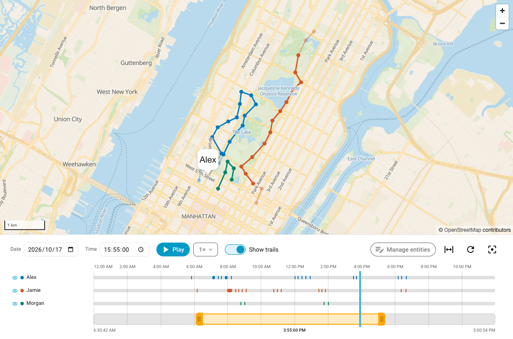
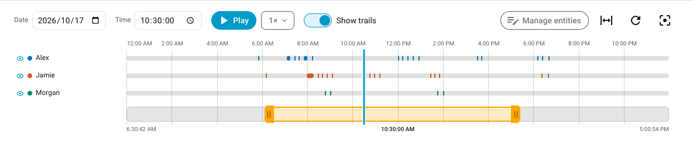
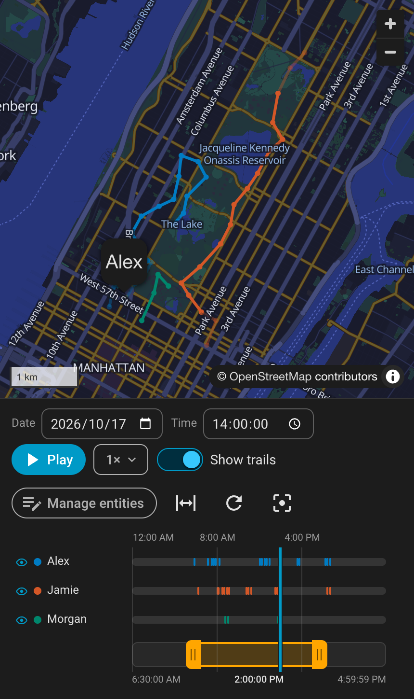

# Location History Card for Home Assistant

Replay the positions Home Assistant Recorder saved for people and device trackers. The card uses Home Assistant's map, fills a Panel view, and lets you scrub the day or play back a selected time range.

[](https://my.home-assistant.io/redirect/marketplace_repository/?owner=tellok&repository=ha-location-history-card&category=integration)

> [!TIP]
> **See your family and friends on the map.** The [ha-apple-find](https://github.com/tellok/ha-apple-find) integration automatically updates locations in Home Assistant for family members and friends who share their location with you through Apple Find My. Use this card to see their latest recorded locations and replay their routes.

## Screenshots

These screenshots use fictional people and tracks around Central Park.

### Desktop Panel



### Playback range



### Mobile Panel



## Install

Requires Home Assistant 2026.11.1 or later, with the built-in Marketplace.

1. Open **Settings → Marketplace** and search for **Location History Card**. If it does not appear, choose **Add from link** and enter `https://github.com/tellok/ha-location-history-card`.
2. Install **Location History Card**. Restart Home Assistant if prompted.
3. Go to **Settings → Devices & services → Add integration → Location History Card**. The integration registers the JavaScript module automatically when Lovelace resources are managed in storage mode.
4. Refresh the dashboard and add **Location History** from the card picker. For a full-screen map, use a **Panel** view with one card.

If you already have a local installation with the `location_history_card` domain, install the Marketplace release over it. Home Assistant reuses the existing integration entry, and the card type stays `custom:location-history-card`.

## Use the card

The minimum manual card configuration is:

```yaml
type: custom:location-history-card
```

The card replays recorded coordinates for `device_tracker` entities and `person` entities linked to a tracker that provides coordinates. It includes people automatically and shows people linked to trackers that report coordinates or identify themselves as GPS trackers by default. In a storage-mode dashboard, administrators can open **Manage entities** to add device trackers or remove people from the card. Use the eye beside an entity to toggle its map and timeline visibility. Your browser remembers those choices for your Home Assistant account.

Drag anywhere in the timeline to seek. Drag either orange handle to trim playback, or move the playhead beyond a handle to extend the range. Faded tracks give context outside the range. **Fit selected time range** frames the recorded points within the range for the visible entities.

You can optionally add these card settings:

```yaml
type: custom:location-history-card
entities:
  - device_tracker.example_phone
excluded_people:
  - person.example
movement_threshold: 50
show_trails: true
```

`movement_threshold` is the minimum displacement in metres used to identify movement periods on the timeline. The map draws consecutive distinct Recorder positions with straight lines. The available dates and coordinates depend on your Recorder retention and what your trackers report.

Licensed under the [MIT License](LICENSE).
